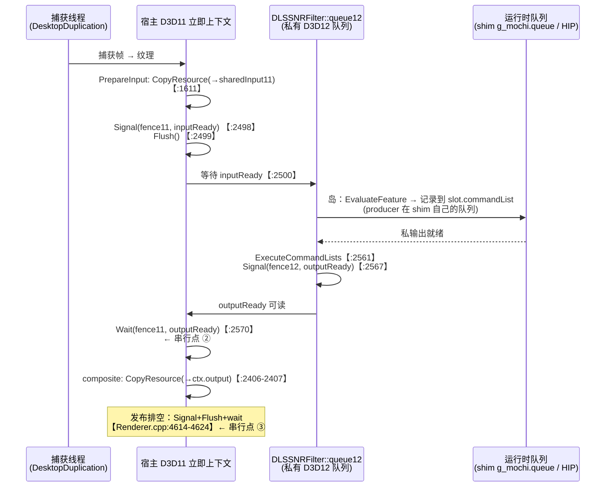

# 线 1 单槽拆解：在新链（线 2 已实线）上的剩余收益重算与立项判断

> 2026-11-04。对象：`docs/2026-11-04-P2-milestone.md`（线 2 P2 实测）与 `docs/2026-11-03-D1-line2-P0.md`（G0 勘误 + 用户裁决「线 1 先不做」）。
> 本机无 9070 XT，**本文不含任何新实测**；所有数字按【实测】/【源码】/【推算】标注，推算处给出算式。
> 源码引用基线：宿主 `SAOG0721/Magpie` experimental @ `6940f84` + 本仓库 `src/magpie-patches/0003-dlssnr-amd-slot.patch`。

---

## 0. 结论摘要

| # | 结论 | 依据 |
|---|---|---|
| 1 | **0001/0002 对新链完全无效**：它们只改 `FSR3Upscaler.cpp/.h`，而新链的 NR 岛在 `DLSSNRFilter.cpp` | 补丁 `diff --git` 头 + `DLSSNRFilter::Draw` 源码 |
| 2 | **brief 里"DLSSNR 槽自己就是单槽串行"需修正**：`commandList12`/`allocator12` 只在 Initialize 用；逐帧路径走**上游自带的 4 槽命令环**（`COMMAND_SLOT_COUNT = 4`）。真正单份的是**共享纹理** `sharedInput11/Output11`（含 D3D12 孪生） | `DLSSNRFilter.cpp:545/592/2468/2470` |
| 3 | 里程碑的 **0.35 档「现状 ~105 fps」是错的**（旧链实测值误抄）。按其自身模型应为 **~135 fps** | `docs/2026-11-04-P2-milestone.md:33` vs `:22-26` |
| 4 | 里程碑 **73 fps 锚点是残差推导**（D'=5.7 由 19.4−13.7 反推），**未独立测量**，不能作"两锚齐、可直接立项" | `docs/2026-11-04-P2-milestone.md:22-31` |
| 5 | **D1 的两档修正预期（0.5档 110–120、1.0档 50–56）无法由同一标量公式复现** —— 反解的 η 区间 **1.0 档 [0.234, 0.569]、0.5 档 [0.680, 0.913] 不相交**。口径需统一并写死；低档台阶更接近满步 ⇒ 0.5/0.35 档的现实目标应作**下界**读 | `docs/2026-11-03-D1-line2-P0.md:58-59` + 本文 §2.1 复算 |
| 6 | **立项判断：挂起（defer），但只挂「写补丁」这一步**。先跑 4 个**零补丁代码**的实测点（见 §5.3），任一门槛不达标即正式关闭线 1 | 本文 §5 |
| 7 | 达标情形下，**新链现实目标**（ratio 0.72 口径）：1.0 档 51.5→~61 fps、0.5 档 110→~131 fps、0.35 档 135→~147 fps（后两档的形状感知上界为 139–154 / 151–158 fps） | 本文 §2 |

**一句话**：线 1 的**机制**在新链依然成立（岛仍被焊在 D3D11 队列上），但**载体换了**（`FSR3Upscaler` → `DLSSNRFilter`）、**前提量全部作废**（ratio、D'、I' 都得在新链重测），而且**天花板被 160 Hz 显示器重新封顶**。在拿到 §5.3 的四个实测点之前，任何补丁投入都是赌博。

---

## 1. 新链的帧时间模型

### 1.1 新链的实际结构（源码）

线 2 之后，NR 岛在 `DLSSNRFilter::Draw`（`DLSSNRFilter.cpp:2394`）内，与宿主 D3D11 立即上下文之间的时序：



**三个串行点，与旧链逐点对应：**

| 串行点 | 旧链（`FSR3Upscaler`） | 新链（`DLSSNRFilter`） | 备注 |
|---|---|---|---|
| ① CPU 侧等上一帧 | `FSR3Upscaler.cpp:497` `WaitForFence(lastSubmittedValue)` | `DLSSNRFilter.cpp:2470` `WaitForFence(slot.completionValue)` | 新链等的是**本槽 4 帧前**的完成值 → **稳态恒为 0**（见 §1.3） |
| ② D3D11 侧被岛焊住 | `FSR3Upscaler.cpp:577` `context11->Wait(fence11, outputReady)` | `DLSSNRFilter.cpp:2570` `context11->Wait(fence11, outputReady)` | **结构完全同构** |
| ③ 发布排空（宿主，不在补丁范围） | `Renderer.cpp:4614-4624` | 同左 | 未变 |

**外加纹理复用依赖**：旧链 `sharedInput11/Output11` 单份（`FSR3Upscaler.cpp:318-319`）；新链同样单份（`DLSSNRFilter.cpp:594-595`、D3D12 孪生 `:628-629`）。这是 multislot.md 里 F3 不变量对应的那一条。

### 1.2 关键差异：上游已自带 4 槽命令环

```cpp
// DLSSNRFilter.cpp:545
static constexpr uint32_t COMMAND_SLOT_COUNT = 4;
// :592-593
std::array<CommandSlot, COMMAND_SLOT_COUNT> commandSlots;
uint32_t nextCommandSlot = 0;
// :2468（逐帧路径）
Impl::CommandSlot& slot = impl.commandSlots[impl.nextCommandSlot++ % Impl::COMMAND_SLOT_COUNT];
// :2470
if (slot.completionValue && !WaitForFence(impl, slot.completionValue)) return fail("slot-wait");
```

`CommandSlot` 内含各自的 `allocator` + `commandList` + `completionValue` + `timestampQuery`（`:559-568`）。
`impl.commandList12` / `impl.allocator12`（`:590-591`）**只在 Initialize 用**（CreateFeature `:2218/:2263`、Close+Execute `:2275-2282`），逐帧不碰。

**这条修正的意义**：0001 补丁的"阶段 1"（多槽环 + 每槽 allocator/list + 每槽围栏值）想做的事，**上游在 `DLSSNRFilter` 上已经做了一半**（命令列表维度）。但**共享纹理仍是单份** —— 而这恰恰是"输出晚一帧"（0002）的**必要前提**：不把 `sharedInput11/Output11` 做成环形，下一帧的 `PrepareInput` 会覆盖上一帧岛还在读的输入纹理。

> **纠正 brief**：brief 写的"`sharedInput11/sharedOutput11/commandList12/allocator12` 各只有一份 → DLSSNR 槽自己就是单槽串行"，前半对、后半的归因错。`commandList12`/`allocator12` 单份不构成串行（逐帧不用）；真正的单份是**纹理**，真正的串行点是 `:2570` 的 D3D11 侧等待。

### 1.3 为什么"阶段 1 收益 = 0"在新链上**更强**地成立

旧链的论证（multislot.md §1.3）：串行点 ③（发布排空，每发布帧把 D3D11 队列排空一次）使 CPU 侧等待本已无意义，故 0001 的 CPU 侧收益为 0。

新链上同一条论证更强：
- 串行点 ③ 未变（`Renderer.cpp:4614-4624`）；
- 且 `slot.completionValue` 来自**本槽 4 帧前**的岛（D'=4 槽轮转），在串行点 ③ 之下必然早已完成 → **CPU 侧 `WaitForFence` 稳态恒返回**。

⇒ **在新链上，"只做纹理环（阶段 1 等价物）"的 CPU 侧收益同样是 0**，它只能作为"输出晚一帧"的铺路。**净收益必须用阶段 2 整体衡量**，不能用阶段 1 单独测。这也意味着：新链的阶段 2 = **纹理环 + 输出晚一帧**必须**一起做**，拆开测必然得到"阶段 1 = 0"的假失败。

### 1.4 D' 与 I' 的取值与来源

新链 P2 实测只有一个点：**s = 1.00、4K、Magpie 渲染率 100%、passes = 1 → 19.2–19.6 ms（51–52 fps）【实测】**。

| 量 | 取值 | 来源 | 标注 |
|---|---|---|---|
| `T_sum(1.0)` | 19.2–19.6 ms（取 19.4） | P2 实测 | 【实测】 |
| `I'(1.0)`（岛 = 网络 + 槽开销） | 13.7 ms | 旧链五点拟合 `6.7+1.4+13.7·s²` 的网络项，**假设新链网络成本不变** | 【推算】⚠️ 假设 |
| `D'`（捕获/呈现 + 槽开销） | 5.7 ms | **残差**：19.4 − 13.7 | 【推算】⚠️ 未独立测量 |
| 旧链 `D` | 6.7 + 1.4 = 8.1 ms | B1/B2 实测 | 【实测】 |

**这个残差拆分有三个已知问题**（必须写进任何后续文档）：

1. **`D' = 5.7` 与 160 Hz 显示器存在张力**。D1 勘误（`docs/2026-11-03-D1-line2-P0.md:54-55`）：B1 的 150 fps 带 `FrameRate_Filter(155)` 帽；拉到 240 停在 **160 = 显示器刷新帽**，故"真实捕获/呈现天花板 ≥160、未知"。若捕获/呈现的真实地板是 6.25 ms（160 Hz），则 `D' = 5.7 ms`（175 fps）要求**捕获/呈现本身 < 5.7 ms**，与"地板 ≥160 且未知"不冲突但**从未被独立验证**。`D'` 只能当残差用，不能当地板。
2. **`I'(1.0) = 13.7` 是旧链拟合值**。旧链该值由 A 组五点反推，其间含旧链的 FSR4 岛耦合与 mochinr 桥接开销。新链的网络输入/输出拓扑不同（宿主 AMDOF 直接喂 MVec/Depth，见 D1 `:25-26`；shim 另有一份 producer/consumer 拷贝），**I' 未必等于 13.7**。若新链网络更便宜（例如省掉网络内自算光流），`I' < 13.7` → `D' > 5.7` → **天花板反而更高**。
3. **FRF 与显示刷新帽的取值未定**：`FrameRate_Filter` 默认 155，但 D1 记录"拉到 240 停在 160"。引用"160 帽"作天花板前必须先钉死这个上限是 155 还是 160。

### 1.5 ⚠️ 里程碑"三档"的轴是**网络内部渲染率**，不是 Magpie 渲染率

这是全案最容易读错、也最影响结论的一点（对应 brief 的可疑点 #3）。

| 轴 | 是什么 | 由什么控制 | 对 `D'` / `I'` 的影响 |
|---|---|---|---|
| **s**（网络内部渲染率） | 网络自己渲染的分辨率比例（0.25–1.0） | shim 环境变量 `MOCHI_SHIM_SCALE` → `fi.model_scale`（`passthrough.cpp:359`、`MochiNrApi.h:130`）；旧链对应 `mochinr` 的 `model_scale`（`mochinr.cpp:81/719`） | `I'(s) = 13.7·s²`；`D'` 近似不变（4K 拷贝不缩，与 findings.md #7「Scale 只缩网络，不缩光流与拷贝」一致） |
| **Magpie 渲染率** | 游戏渲染分辨率 / 输出分辨率 | Magpie 的缩放设置 | 渲染率 < 100% 时**必须重新引入 FSR4 类放大器**（`NativeEffectBackendFactory.cpp:243` → `FSR3Upscaler`），固定底与岛成本全变 → **里程碑的模型整表作废** |

**结论**：里程碑表头写"渲染率"、行值 1.0/0.5/0.35，**实际是 s 轴**（因为 `I' = 13.7·s²`）。在 s 轴上 `D'` 不变、只有 `I'` 变 —— 这与里程碑自身的算式一致，但**表头用词会让人误读成 Magpie 渲染率**。本文一律改称 **"网络档 s"**。

### 1.6 D' 在两种情形下是否相同

- **在 s 轴上（网络档）**：**相同**。`D' ≈ 5.7` 与 s 无关（4K 拷贝/捕获/呈现不随网络分辨率缩放）。
- **在 Magpie 渲染率轴上**：**不同**，且未建模。渲染率 0.5 需要 FSR4 槽回到链里（`FSR3Upscaler`），固定底会**增加**（旧链的 1.4 ms 槽位成本是这一类开销的样本），网络输入也随源分辨率变化 → `D'`、`I'` 同时变。
- **在 100% vs 半分辨率的"网络档"情形**：`D'` 相同，但**天花板不同**（§2）。

---

## 2. 剩余收益表

### 2.1 打折口径（推荐，与 multislot.md 分档表自洽）

multislot.md:171-173 的三档判决是明确的：`ratio > 0.85` 停 / `0.60 ≤ ratio ≤ 0.85` 打折 / `ratio < 0.60` 台阶成立（按满步验收）。
brief 提议的 `T_target = max(B2, T_sum − (1−ratio)·ΔT)` 与该分档表**不自洽**：ratio = 0.5（GPU 很闲）时它只给 50% 台阶，而分档表要求"满步"。

本文采用：

```
ΔT(s)     = T_sum(s) − T_max(s)                    # 理想台阶
T_max(s)  = max( D_floor , max(D_side(s), I'(s)) )  # 完美重叠上限
η(r)      = 1                r ≤ 0.60              # 台阶成立（multislot.md:173）
           = (0.85 − r)/0.25   0.60 < r ≤ 0.85      # 打折带，线性
           = 0                r > 0.85             # 台阶不存在（multislot.md:172）
T_target(s) = max( D_floor , T_sum(s) − η(r)·ΔT(s) )
D_floor     = 6.25 ms                                   # 160 Hz 显示器周期（用户可见上限）
```

三处说明：
- **`D_floor` 是用户可见地板**。160 Hz 显示器下，`T_target` 低于 6.25 ms 只是内部跑得更快，用户看不到更多帧 ⇒ 下限取 6.25 ms（若 `FrameRate_Filter` 仍为 155，则下限应是 6.45 ms，见 §1.4 第 3 点）。
- **η 的形状依据**：分档表要求 r ≤ 0.60 满步、r ≥ 0.85 零步，中间线性过渡是唯一同时满足两端点的单调形式。GPU 越闲（r 越小）能腾出的重叠窗口越多 ⇒ 台阶越大 —— 方向与物理一致。
- **形状依赖的警告**：上式是**标量折扣**，隐含"遮挡与被遮挡等比例"。实际上台阶大小取决于**形状**：当 `I'(s) ≤ D_side`（岛比 D 侧短）时，岛可以整段藏进 D 侧窗口，台阶接近满步；当 `I'(s) > D_side` 时岛本身是长杆，收益受"非重叠部分"限制。
  **对 D1 旧链两档数字的复算**（`docs/2026-11-03-D1-line2-P0.md:59` 的 0.5 档 110–120、1.0 档 50–56）。反解方式：`η = (T_sum − T_target)/ΔT`，`T_target = 1000/fps`：

  | 档 | `T_sum`（实测） | `B2` | `T_max` | `ΔT` | D1 目标区间 (fps) | 折算 ms | **反解 η 区间** |
  |---|---|---|---|---|---|---|---|
  | 1.0 | 21.5 ms | 8.05 | 15.1 | 6.4 | 50 – 56 | 17.86 – 20.0 | **0.234 – 0.569** |
  | 0.5 | 11.3 ms | 8.05 | 8.05 | 3.25 | 110 – 120 | 8.33 – 9.09 | **0.680 – 0.913** |

  ⇒ **两档 η 区间不相交（0.569 < 0.680，中间有缺口）** ⇒ **D1 的两个数字无法由任何单一标量公式复现**。逐式验证（r = 0.69 / 0.72 / 0.74）：

  | 公式 | 1.0 档算出 (fps) | 命中 50–56？ | 0.5 档算出 (fps) | 命中 110–120？ |
  |---|---|---|---|---|
  | A：`max(B2, T_sum − (1−r)·ΔT)`（brief 提议） | 51.2 / 50.7 / 50.4 | **是** | 97.2 / 96.2 / 95.6 | 否（低 ~14） |
  | B：`max(B2, T_sum − r·ΔT)` | 58.5 / 59.2 / 59.7 | 否（高 ~3） | 110.4 / 111.6 / 112.4 | **是** |
  | D：`max(B2, T_sum − (1−r)·T_sum)`（`multislot.md:174` 的"空闲"式） | 67.4 / 64.6 / 62.9 | 否（高 ~8） | 124.2 / 122.9 / 119.6 | 否（高 ~3） |
  | **C：`η = (0.85−r)/0.25`（本文推荐）** | 57.5 / 55.0 / 53.5 | **是**（r ≥ 0.72） | 108.5 / 104.1 / 101.3 | 否（低 ~6） |

  ⇒ **口径必须先统一并把 η 写死**。四点推论：
  1. 本文的线性斜坡 C 在 **1.0 档命中** D1 区间（r = 0.72/0.74 时 η = 0.52/0.44 落在 [0.234, 0.569] 内）⇒ **对决策关键档（1.0 满质量 4K）的标定是可信的**。
  2. C 在 **0.5 档偏低**（104 fps vs D1 的 110–120，差 ~6 fps）⇒ 说明**低档台阶比标量模型给的更接近满步**。这不是模型出错，而是**台阶大小确实依赖形状**：`I'(s)` 变短时岛可以整段藏进 D 侧窗口，形状对 η 的约束放松。C 是一维保守值，**低档的真实收益更接近 §2.2 的"形状感知上界"**。
  3. 推论 2 直接影响 §2.2：**0.5 / 0.35 档的现实目标（131 / 147 fps）应视为下界**，形状感知上界分别是 **139–154 fps**（0.5 档）与 **151–158 fps**（0.35 档）。1.0 档不受影响（η 区间落在同一带内）。
  4. 即便如此，实盘仍应以 §5.4 的门槛为准（本表全部建立在**旧链** ratio 0.69–0.74 上，新链必须重测）。

### 2.2 三档收益表

**共用量**：`D_side = 5.7`（残差）、`I'(s) = 13.7·s²`、`D_floor = 6.25`、`T_sum(s) = D_side + I'(s)`。

#### 档 s = 1.0（网络 4K，Magpie 渲染率 100%）

| 项 | 值 | 算式 / 来源 |
|---|---|---|
| 现状 | **51.5 fps / 19.4 ms** | 【实测】P2 19.2–19.6 ms |
| 理想上限 `T_max` | **73.0 fps / 13.7 ms** | `max(6.25, max(5.7, 13.7)) = 13.7`；与里程碑 ~73 fps 一致 |
| 理想台阶 `ΔT` | 5.7 ms | 19.4 − 13.7 |
| 现实目标 r ≤ 0.60 | **73.0 fps** | 满步 |
| 现实目标 r = 0.72 | **60.8 fps** | 19.4 − 0.52×5.7 = 16.44 ms |
| 现实目标 r = 0.76 | **57.6 fps** | 19.4 − 0.36×5.7 = 17.35 ms |
| 现实目标 r ≥ 0.85 | **51.5 fps** | 零台阶 |
| 上限受显示器封顶？ | 否（73 < 160） | — |

#### 档 s = 0.5（网络 2K，Magpie 渲染率 100%）

| 项 | 值 | 算式 |
|---|---|---|
| 现状 | **109.6 fps / 9.13 ms**【推算】 | 5.7 + 3.425 = 9.13；与里程碑 ~110 一致 |
| 理想上限 `T_max` | **160 fps / 6.25 ms** | `max(6.25, max(5.7, 3.425)) = 6.25`（**被显示器封顶**） |
| 理想台阶 `ΔT` | 2.88 ms | 9.13 − 6.25 |
| 现实目标 r ≤ 0.60 | **160 fps** | 满步 |
| 现实目标 r = 0.72 | **131 fps** | 9.13 − 0.52×2.88 = 7.63 ms |
| 现实目标 r = 0.76 | **124 fps** | 9.13 − 0.36×2.88 = 8.09 ms |
| 现实目标 r ≥ 0.85 | **110 fps** | 零台阶 |
| **形状感知上界** | **139 – 154 fps** | 取 D1 旧链 0.5 档隐含 η∈[0.680, 0.913]（§2.1）⇒ 6.50–7.17 ms。低档台阶更接近满步 ⇒ **131 fps 应视为下界** |

#### 档 s = 0.35（网络 1.4K，Magpie 渲染率 100%）

| 项 | 值 | 算式 |
|---|---|---|
| 现状 | **135.5 fps / 7.38 ms**【推算】 | 5.7 + 1.678 = 7.38；**里程碑写 105 fps 是错的**（见 §6 第 1 条） |
| 理想上限 `T_max` | **160 fps / 6.25 ms** | `max(6.25, max(5.7, 1.678)) = 6.25`（**被显示器封顶**） |
| 理想台阶 `ΔT` | 1.13 ms | 7.38 − 6.25 |
| 现实目标 r ≤ 0.60 | **160 fps** | 满步 |
| 现实目标 r = 0.72 | **147 fps** | 7.38 − 0.52×1.13 = 6.79 ms |
| 现实目标 r = 0.76 | **143 fps** | 7.38 − 0.36×1.13 = 6.97 ms |
| 现实目标 r ≥ 0.85 | **135.5 fps** | 零台阶 |
| **形状感知上界** | **151 – 158 fps** | 同上 η∈[0.680, 0.913] ⇒ 6.35–6.61 ms |

### 2.3 ratio 敏感度汇总（现实目标 fps）

| 档 | r ≤ 0.60 | r = 0.69 | r = 0.72 | r = 0.74 | r = 0.76 | r = 0.85 |
|---|---|---|---|---|---|---|
| s = 1.0 | 73.0 | 63.5 | 60.8 | 59.2 | 57.6 | 51.5 |
| s = 0.5 | 160 | 136 | 131 | 128 | 124 | 110 |
| s = 0.35 | 160 | 149 | 147 | 145 | 143 | 135.5 |

**读法**：ratio 从 0.72 走到 0.85，1.0 档的现实目标就从 60.8 掉到 51.5（**归零**）；而 0.5/0.35 档因为被显示器封顶，对 ratio 钝感得多。**这直接决定立项的性价比**：收益最大、也最脆弱的是 1.0 档（满质量 4K 降噪）；收益最稳的是 0.5 档（网络降到 2K）。

**这张表是"标量下限"**。按 §2.1 的形状感知上界，0.5 / 0.35 档在 r = 0.72 处实际可到 **139–154 / 151–158 fps**（低档台阶更接近满步）；1.0 档不变（η 区间落在同一带内）。

### 2.4 三个前提量全部未在新链测过

| 量 | 旧链取值 | 新链状态 |
|---|---|---|
| ratio（GPU 忙占比） | 0.69–0.74（D1 `:58`，**在旧链测的**） | **未测**。新链无 FSR4 槽、网络走宿主 AMDOF，引擎占用结构已变 |
| `D'` | 8.1（旧链 B1/B2 实测） | **未独立测**，只有残差 5.7 |
| `I'(1.0)` | 13.7（旧链拟合） | **未独立测**；旧链该值含 FSR4 岛耦合与 mochinr 桥接 |

**同时提醒**：ratio 必须**逐档测**（s=1.0 时网络占 71% 帧时间，与 s=0.35 时的引擎占用结构完全不同），且旧链的 0.69–0.74 **不可沿用**（链已变）。

---

## 3. 可能的收益点清单

### (a) 结构性主收益

**A1｜D3D11 侧与岛重叠（线 1 的正身）**
- **机制**：把 `DLSSNRFilter.cpp:2570` 的 `context11->Wait(fence11, outputReady)` 从"等本帧岛"改成"等上一帧岛"，配合**环形共享纹理**（`sharedInput11/Output11` + D3D12 孪生按槽分配），使 D3D11 侧的 capture→copyIn→copyOut→发布排空能与 queue12 上的岛并发。
- **量级**：见 §2.2。1.0 档最多 51.5→73 fps（r ≤ 0.60），现实 51.5→58~61 fps（r = 0.72~0.76）；0.5 档 110→124~131 fps（形状感知上界 139–154 fps）。
- **前提**：① 新链 ratio 实测；② `D'`/`I'` 实测；③ 纹理环 + 输出晚一帧必须**同时**做（§1.3）。
- **风险**：输出晚一帧 ⇒ **用户看到的画面晚一帧**（F10 同类语义代价，`multislot.md §3.7`）；且新链 `DLSSNRFilter` 的帧身份机制（`cache.FirstDirty` `:2433`、`duplicateFrameReuseCount` `:2440`、`lastGuidanceResetFrameId` `:2517`）全部按 `context.frameId` 组织，晚一帧必须逐项对齐，否则出"画面与元数据错位"。

**A2｜shim 侧的 producer/consumer 跨队列已部分重叠**
- **机制**：shim 把 producer（`RecordInputs`）与 HIP 提交放在**自己的队列** `g_mochi.queue`（`passthrough.cpp:377-387`），只有 consumer（`RecordOutputs` + `CopyResource(output←priv)`）在宿主 list 上（`:389-399`）。即"网络重活"已经不在宿主 queue12 上。
- **量级**：不定量。它意味着**线 1 原始的"求和"模型在新链上未必精确成立** —— 部分重叠可能已经发生。这既是好消息（新链可能比模型更宽松）也是坏消息（模型的前提要重推）。
- **风险**：这是 §5.3-M4 之所以重要的原因 —— 只有实测能定"重叠已发生多少"。

**A3｜多趟 / 多 pass 的残余**
- **机制**：`laterPasses` 链（`DLSSNRFilter.cpp:2244-2245` 把上一趟的 `sharedOutput11` 直接接成下一趟的 `sharedInput11`）与 `DLSSNRMultiPass` 的 `_rawOutput` **单份**（`DLSSNRMultiPass.h:176`）在晚一帧下会互相踩。
- **量级**：不是收益，是**必须付的实现成本**。
- **风险**：抗闪烁开启时 `_rawOutput` + `DLSSNRTemporal` 会读到被覆盖的纹理 ⇒ 晚一帧方案必须连带把 `_rawOutput` 也做成环形。

### (b) 载体迁移类（**成本，不是收益**）

**B1｜0001/0002 在新链上一行都不生效**
- 事实：两个补丁的 `diff --git` 只有 `src/Magpie.Core/FSR3Upscaler.cpp` 与 `.h`（`src/magpie-patches/0001-fsr3-slot-ring.patch:15/545`、`0002-fsr3-output-lag.patch:15`）。新链的岛在 `DLSSNRFilter.cpp`。
- 后果：`FSR3Upscaler` 在 100% 渲染率 + DLSSNR-only 效果组下**根本不会被实例化**（`NativeEffectBackendFactory.cpp:243` 只在效果名为 `FSR4\FSR4_SR` 时创建 `FSR3Upscaler`）⇒ 补丁是**死代码**。
- 动作：补丁与 `src/magpie-patches/README.md` 应标注"旧链专用"，否则后人会在新链上误以为已覆盖。

**B2｜新载体要写的东西比 0001+0002 更多，不是更少**
| 维度 | 0001+0002（`FSR3Upscaler`，601 行） | 新载体（`DLSSNRFilter`，2648 行） |
|---|---|---|
| 命令列表/分配器多槽 | 要写 | **上游已有 4 槽**（`:545/592/2468`）→ 省 |
| 共享纹理环形 | 要写 | 要写，且**更难**：`laterPasses` 串接（`:2244-2245`）要求槽 × 趟矩阵 |
| 输出晚一帧 FIFO | 要写 | 要写，且要处理 `cache`/`duplicateFrameReuse`/`lastGuidanceResetFrameId` 的帧身份 |
| 残差/上采样路径 | 无 | `useResolutionScaling` → `CompositeResidual`（`:1757`）+ 下采样 pass，**额外一条输出路径** |
| 抗闪烁 | 无 | `DLSSNRMultiPass` `_rawOutput` 单份 + `DLSSNRTemporal` |
| 失败语义 | 逐帧 `return false` → 宿主 marker pass 回退（F7/F16 成立） | `fail()` 置 `impl.disabled = true`（`:2412`）→ **单 pass 失败 = 整个会话的 NR 永久停用**；多 pass 失败 → `Renderer.cpp:4147-4152` `_FailColorPipeline` **整条缩放停掉**。**F7/F16 在新载体上不成立，需额外改** |
| 围栏等待上界（F13） | 0001 补 4000 ms + poison | `DLSSNRFilter::WaitForFence`（`:934-956`）**无超时**（`fenceEvent.wait()` 无限等）→ 需另补 |
| 相对体量 | +401 / −82 行（`0001` +314/−66，`0002` +87/−16） | 预计**≥ 同量级**，且分布在更复杂的文件 |

**B3｜必须改的文件（若立项）**
- `src/Magpie.Core/DLSSNRFilter.cpp`（纹理环、输出晚一帧、围栏等待上界、失败语义对齐 F7/F16）
- `src/Magpie.Core/DLSSNRFilter.h`（槽结构声明）
- `src/Magpie.Core/DLSSNRMultiPass.h`（`_rawOutput` 环形，抗闪烁路径）
- 新补丁文件（建议 `src/magpie-patches/0004-dlssnr-slot-lag.patch`），**基线仍为 `6940f84`**，且必须声明"依赖 0003（AMD 槽路径）"
- **不动** `FSR3Upscaler.cpp`（新链不含它）；**不动** `Renderer.cpp`（串行点 ③ 归属另一条主线，动了就分不清归因，`multislot.md §7.3`）

### (c) 已不是收益点的项

**C1｜线 2 白拿的 ~2.1 ms（21.5 → 19.4）** —— 已落袋，属"适配层拆除"，**不是线 1 的收益**，也不可与线 1 收益相加（它已经体现在 19.4 这个基数里）。

**C2｜旧链的 1.4 ms「FSR4 槽位」** —— 在新链 100% 渲染率下**根本不存在**（`FSR3Upscaler` 不实例化）。既不是收益也不是成本项，从新链账本里删掉。

**C3｜抗闪烁（线 3）** —— D1 已确认 MVec/Depth 在 slot0、宿主提供，"免费"指的是**不必自研光流**，不是零成本：`DLSSNRTemporal` 要跑一次全分辨率时域 dispatch，且 `experiments-2026-11-03.md:238` 记 271 MiB 显存。**它是功能不是帧率收益，且它消耗的正是线 1 想争取的 GPU 余量**（两者在同一张卡上竞争，见 `experiments-2026-11-03.md:305-307` 的互斥记录）。

**C4｜多趟（passes > 1）** —— 功能（更强降噪），**每趟多一次网络，成本上升**。P2 实测是 passes = 1（`passthrough.cpp:363-367`，`MOCHI_SHIM_PASSES` 1..3）；`MochiNrApi.h:131` 允许 1..3（mochizuki 1..30）。不是收益。

**C5｜"1.9 ms"这个具体数字** —— 21.5 − 19.4 = **2.1 ms**（区间 1.7~2.5），里程碑写 1.9 是取区间某点。新链账本一律用"~2.1 ms"并注明区间。

---

## 4. 载体结论（回答 brief 的第 4 组问题）

**Q：重叠收益该在哪里做？**
⇒ **`src/Magpie.Core/DLSSNRFilter.cpp`**（+ `.h` + `DLSSNRMultiPass.h`）。**不是** `FSR3Upscaler.cpp`。

**Q：相对 0001/0002 工作量是增是减？**
⇒ **增**（或至少持平偏增）。命令列表维度上游已白送（省 0001 的一部分），但共享纹理环形、输出晚一帧的帧身份对齐、`cache`/`duplicateFrameReuse` 语义、残差路径、抗闪烁 `_rawOutput`、F7/F16 失败语义、F13 超时 —— 这些在 `FSR3Upscaler` 上都不存在。**新载体是 2648 行、多趟、带残差、带抗闪烁、带帧缓存的文件。**

**Q："阶段 1 收益 = 0"在新链上是否仍成立？**
⇒ **成立，且更强**（§1.3）：串行点 ③ 未变 + `slot.completionValue` 来自 4 帧前 ⇒ CPU 侧等待稳态恒 0。所以：
- 新链上**不要**单独测"阶段 1"（必然得到 0，是假失败）；
- 要测就把**纹理环 + 输出晚一帧**一起做，整体对现状比。

**Q：需要在哪个链上重测？**
⇒ **必须在新链上**（DLSSNR 原生槽 + `amdgx_dlssnr.dll` + 真网络）。旧链的 FSR4 槽已不存在，旧链的比值与残差对新链没有约束力。

---

## 5. 立项判断

### 5.1 判决：**挂起（defer）**

**不是"不做"**：机制在新链依然成立（`:2570` 的焊点、共享纹理单份），天花板在 1.0 档仍有 51.5 → 73 fps 的空间。
**也不是"做"**：所有决定性前提量在新链都未测，且其中两个（ratio、`D'`/`I'` 拆分）**当前无法从现有数据推出来**；载体迁移的工作量比原设计更大。

### 5.2 挂起的具体理由（按权重排序）

1. **前提量全部作废，且不可外推**：旧链 ratio 0.69–0.74 是在"FSR4 槽 + ReShade + mochinr"链上测的；新链是"DLSSNR 原生槽 + shim + 宿主 AMDOF"，引擎占用结构已变。§2.3 显示 ratio 从 0.72 走到 0.85，1.0 档现实目标从 60.8 归零到 51.5 —— **在一个未测参数上做 ±10 fps 的投资决策是不理性的**。
2. **天花板被 160 Hz 重新封顶**：旧链 0.5 档天花板是 B2 = 123–125 fps（结构性）；新链 0.5/0.35 档天花板是**显示器刷新率** 160 fps。用户可见收益上限被硬件锁死，且 FRF(155) 与显示帽(160) 谁生效还没钉死（§1.4 第 3 点）。
3. **`D' = 5.7` 是残差，不是测量**。它要求"新链网络成本 = 旧链 13.7 ms"这一未验证假设；而 §1.4 第 2 点指出新链网络**可能更便宜**（宿主直接喂 MVec/Depth，省掉网络内自算光流）⇒ `D'` 可能更大、上限更高。**结论对输入敏感 ⇒ 必须先测。**
4. **载体迁移成本高于原设计**（§4 的 B2 表），且新载体的失败语义更严苛（`fail()` → `impl.disabled`；多 pass 失败 → 整条缩放停掉），需要额外设计才能满足 F7/F16。
5. **有更便宜、更高确定性的替代路径摆在前面**：里程碑自己的 v0.6 清单第 1 条（面板接线：`DLSSNR.Intensity/Style/Reset` → `MochiNrSetControls` + `MochiNrFrameInfo`）**尚未做**，且它是交付形态的必需品，不依赖任何未测量。

### 5.3 最小验证路径（**全部零补丁代码**；只需在 9070 XT 上跑）

前置：把 `src/nvngx-shim/amdgx_dlssnr.dll` 部署到 Magpie 目录，效果组放 `DLSSNR\DLSSNR_AI_Filter`（`src/nvngx-shim/README.md:53-58` 的流程）。

| 编号 | 测什么 | 怎么做 | 成本 | 判定用途 |
|---|---|---|---|---|
| **M1** | 新链 ratio（**逐档**） | `scripts/measure-gpu-busy.ps1`；协议按 D1 勘误：**关 FRF、游戏限帧设平衡点**；s = 1.0 / 0.5 / 0.35 各一次 | 部署 1 次 + 每档预热 10 s + 采样 60 s → **约 30–45 min** | 算 η(r) → §2.3 现实目标；**r ≥ 0.85 ⇒ 立即关闭线 1** |
| **M2** | `D'` 的独立上界 | `MOCHI_SHIM_OFF=1`（`passthrough.cpp:168-171`，强制直通）跑平衡点 | 1 次运行 → **约 10 min** | 直接量"无网络"帧时间，验 `D' ≈ 5.7` 是否成立（残差 vs 实测） |
| **M3** | `I'(s)` 与 s² 律 | `MOCHI_SHIM_SCALE=0.5` / `0.35`（`passthrough.cpp:359`）各跑一次平衡点 | 2 次运行 → **约 20 min** | 修里程碑 0.35 行的陈旧数字（应为 ~135 fps）；验 `I' = 13.7·s²` 在新链是否成立 |
| **M4** | 岛的**真实 GPU 毫秒** | 宿主 `src/BuildOptions.props.user` 加一行 `EnableNativeBackendTiming=true`（`src/BuildOptions.props:18` → `Magpie.Core.vcxproj:52` 定义 `MP_ENABLE_NATIVE_BACKEND_TIMING`）→ 重编 → 读 `magpie.log` 的 `DLSSNR chain timing: ... evaluateGPU=...`（`DLSSNRFilter.cpp:2585-2591`）与 `DLSSNR GPU pass N: ... ms=`（`:997`） | 1 次宿主重编（VS2022 BuildTools，~10–20 min）+ 1 次运行 → **约 40 min** | **把 `I'` 从残差变成直测**；同时看 `slotWaitTimings` 是否 ≈ 0（验 §1.3） |

**总计约 1.5–2 小时实机时间，零补丁代码。**

### 5.4 立项门槛（跑完 M1–M4 后按此裁决，写死）

| 条件 | 裁决 |
|---|---|
| 任一档 ratio **> 0.85** | **关闭线 1**（吞吐已满，台阶不存在，`multislot.md:172`）。转 §3(c) 的功能项（面板接线 / 抗闪烁） |
| ratio ∈ [0.60, 0.85] **且** M2 实测 `D'` ≥ 7.0 ms | **关闭线 1**：1.0 档现实目标 ≤ ~55 fps（+7%），不值得新载体补丁 |
| ratio ∈ [0.60, 0.85] **且** M2 实测 `D'` ≤ 6.0 ms **且** M4 显示 `slotWait` ≈ 0 | **重开线 1**，但**只做 0.5 档**（网络 2K）：收益 110→131 fps（下限）~154 fps（形状感知上界），且对 ratio 钝感（§2.3）；1.0 档满质量路线单独立项 |
| ratio < 0.60 | **重开线 1**（满步）：1.0 档 51.5→73 fps、0.5 档 →160 fps。**仍先做 M4**，因为它能验证"网络是否已部分重叠"（§3 A2），避免把已存在的收益重复计价 |

### 5.5 若重开，实施顺序（供 v0.6 之后参考）

1. 先做 `laterPasses` × 槽 的纹理矩阵与 `_rawOutput` 环形（不改时序）→ 验证零回归；
2. 再做输出晚一帧（帧身份对齐：`cache`/`duplicateFrameReuse`/`lastGuidanceResetFrameId`/guidance 一致性）；
3. 补 F13 超时（`WaitForFence` 4000 ms 上界 + poison）与 F7/F16 失败语义；
4. 每步都按 `magpie.log` 的 `fenceAvgMs` 与新链的 `slotWait`/`evaluateGPU` 三件套读数，不看帧数单点。

---

## 6. 数字一致性核对（文档间矛盾清单）

| # | 位置 | 冲突内容 | 与什么冲突 | 统一口径建议 |
|---|---|---|---|---|
| 1 | `docs/2026-11-04-P2-milestone.md:33` | 0.35 档"现状 推算 ~105 fps" | 同文 `:22-26` 的模型（`D'=5.7`、`I'=13.7×0.35²=1.68` → **7.38 ms → 135.5 fps**）；105 fps 是**旧链** A@0.35 实测值（`docs/findings.md:178`）被误抄 | 改为 **135 fps**（推算），并注明"旧链 105 fps 不可沿用" |
| 2 | `docs/2026-11-04-P2-milestone.md:26` | 在"新链模型"标题下写 `frame → max(D', I')` | 同文 `:31` 的"现状 51–52（实测）= 19.4 ms" 只能是 **D'+I' 的求和**；`max()` 是**分解后**的上限 | 拆成两行：**现状模型 `T_sum = D' + I'`** / **分解上限 `T_max = max(D_floor, D_side, I')`** |
| 3 | `docs/2026-11-04-P2-milestone.md:22-23` | "旧链 6.7+1.4=8.1 → 再省 ~1 ms" | 同句给出的 `D' = 5.7`（8.1 − 5.7 = **2.4 ms**，不是 ~1 ms）；且 `D'` 是残差不是测量 | 删掉"再省 ~1 ms"，直接写 "`D' = 19.4 − 13.7 = 5.7`（残差，`I'=13.7` 为**假设**）" |
| 4 | `docs/2026-11-03-D1-line2-P0.md:58-59` | 0.5 档 110–120、1.0 档 50–56（旧链口径） | **无法由同一标量公式复现**（复算见 §2.1）：反解 η 区间 **1.0 档 [0.234, 0.569]、0.5 档 [0.680, 0.913]，两区间不相交**。A 式 `T_sum−(1−r)·ΔT` 只命中 1.0 档（50.4–51.2 fps），B 式 `T_sum−r·ΔT` 只命中 0.5 档（110.4–112.4 fps），`multislot.md:174` 的"空闲"式**两档都不命中**（1.0 档 62.9–67.4、0.5 档 119.6–124.2） | 先把 §2.1 的 η 形状写死并回填两档；**在口径统一前，两个数字都不得引用**。同时注明 0.5 档 D1 数字**偏高**（低档台阶更接近满步），引用时应作**上界**而非目标 |
| 5 | `docs/2026-11-03-D1-line2-P0.md:58` | ratio 0.69–0.74 | **旧链**测得（FSR4 槽 + ReShade + mochinr）；新链组成已变 | 标注"旧链值，仅作先验"；以 M1 新链实测替换 |
| 6 | `docs/2026-11-03-D1-line2-P0.md:54-55` vs `docs/2026-11-04-P2-milestone.md:22` | D1："真实捕获/呈现天花板 ≥160、未知"；里程碑：`D' = 5.7`（= 175 fps） | `D' = 5.7` 要求捕获/呈现**快于**已被观测到的 160 fps 呈现节奏 | `D'` 只能当**残差**；地板另立 `D_floor`（显示器/FRF 周期），并把"未知"写成待测项（M2） |
| 7 | `docs/2026-11-04-P2-milestone.md:31` | "两锚齐，可直接立项" | 第二个锚（73 fps）依赖未测的 `D'` 与未测的 ratio（§2.3 显示 r=0.85 时现实目标 = 现状） | 改为"单锚（现状 51–52 实测）；上限待 M1/M4 定" |
| 8 | `docs/2026-11-04-P2-milestone.md:29-33` 表头"渲染率" | 行值 1.0/0.5/0.35 实为**网络内部渲染率 s**（`MOCHI_SHIM_SCALE`/`model_scale`），非 Magpie 渲染率 | 与 §1.5 的两条轴混淆 | 表头改 **"网络档 s"**；Magpie 渲染率另立一列（未测） |
| 9 | `docs/2026-11-04-P2-milestone.md:18` vs `:35` | "−1.9 ms" | 21.5 − 19.4 = **2.1 ms**（区间 1.7~2.5） | 统一写 **~2.1 ms（区间 1.7–2.5）** |
| 10 | `src/magpie-patches/README.md:19` | "FSR3ZeroMVUpscaler … 在链里不承载 NR（岛只有 1.4 ms）" | **仅旧链成立**；新链 100% 渲染率下 `FSR3Upscaler` 根本不实例化（`NativeEffectBackendFactory.cpp:243`） | README 增列"新链适用性"：0001/0002 **旧链专用**，新链载体是 `DLSSNRFilter` |
| 11 | `src/magpie-patches/0001-fsr3-slot-ring.patch` / `0002-…` | 补丁只改 `FSR3Upscaler.cpp/.h` | 新链的岛在 `DLSSNRFilter.cpp` | 补丁头加一行"**不适用于线 2 后的新链**"，避免后人误以为已覆盖 |
| 12 | `docs/2026-11-03-D1-line2-P0.md:59` | 用户裁决"线 1 先不做" | 裁决依据（旧链 ratio/台阶/载体）已随线 2 变化（§0） | 裁决**维持"不做"**，但补一句"新链重算结论：机制仍在、载体换为 `DLSSNRFilter`、前提量需重测（§5.3）" |

---

## 7. 不清楚的地方（UNCLEAR）与建议核对方式

| # | 不清楚 | 为什么重要 | 怎么核 |
|---|---|---|---|
| 1 | 新链 100% 渲染率下效果组里**是否只有** `DLSSNR\DLSSNR_AI_Filter`（不含 FSR4） | 决定 `D'` 是否含放大槽成本（±1.4 ms 量级），也决定 `FSR3Upscaler` 是否存在 | P2 会话的 `magpie.log`：找 `FSR 4.1.1 D3D11/D3D12 backend initialized`（`FSR3Upscaler.cpp:476-479`）是否出现；找 `DLSSNR STATUS: … sourceSize=…`（`DLSSNRFilter.cpp:2314`） |
| 2 | shim 日志 `private=%llux%u`（`passthrough.cpp:408`）在 s<1 时是否仍是 4K | 决定 s 轴上 `D'` 是否真的不变（若 private_output 也缩小，槽内拷贝变小，`D'` 会略降） | 读 P2 会话 shim 日志；s=0.5 时再采一次对比 |
| 3 | 显示刷新上限到底是 **160**（`measurements.md:5` "显示 160 Hz"）还是 `FrameRate_Filter` 的 **155** | 直接决定 0.5/0.35 档的 `D_floor`（6.25 vs 6.45 ms）与 160 帽 | M1/M2 顺带记录：关 FRF 后把游戏限帧拉到 240，看发布帧率停在哪 |
| 4 | 新链网络成本是否仍为 13.7 ms | 决定 `D'` 残差与 `T_max`（§1.4 第 2 点） | **M4**（`evaluateGPU`） |
| 5 | 岛与 D3D11 侧**现在是否已部分重叠** | 若已重叠，"求和"模型不精确，`ΔT` 会被高估 | **M4** 对照 `evaluateGPU` 与帧时间 |
| 6 | `D'` 中"捕获/呈现"与"槽内拷贝"各占多少 | 决定 `D_floor` 是被显示周期（6.25）还是被管线本身决定 | M2（`MOCHI_SHIM_OFF=1`）+ M4 的 `inputPrepare`/`submit` 计时项（`DLSSNRFilter.cpp:2584-2591`） |
| 7 | `T_sum` 是否含发布排空的固定开销（`Renderer.cpp:4614-4624`） | 串行点 ③ 不在补丁范围，其开销会进 `D'` | M4 读 `magpie.log` 的 `fenceAvgMs`（`Renderer.cpp:4636`） |

---

## 8. 出处

**本仓库**
`docs/2026-11-04-P2-milestone.md`（P2 实测 51–52 fps、D'=5.7 推导、73/160/160 三档）、`docs/2026-11-03-D1-line2-P0.md`（G0 勘误、ratio 0.69–0.74、用户裁决）、`docs/findings.md`（A/B 五点与 `6.7+1.4+13.7·s²` 模型、Scale 只缩网络、155 帽勘误）、`docs/experiments-2026-11-03.md`（三线耦合、互斥、显存）、`docs/multislot.md`（单槽设计、F1–F16、三档 ratio 判据、验收线）、`src/magpie-patches/README.md`（补丁用途与适用性）、`src/magpie-patches/0001/0002/0003`、`src/nvngx-shim/passthrough.cpp`（`MOCHI_SHIM_SCALE/PASSES/OFF`、producer/consumer 跨队列）、`src/nvngx-shim/README.md`（部署流程）、`src/nrtest/MochiNrApi.h`（`model_scale` 0.25–1.0、passes）。

**宿主源码（`SAOG0721/Magpie` experimental @ `6940f84`）**
`src/Magpie.Core/DLSSNRFilter.cpp`（`:545` 4 槽常量、`:552` cache、`:559-568` CommandSlot、`:590-595/628-629` 单份纹理与命令列表、`:934-956` 无超时 WaitForFence、`:1534-1535` 参数绑定、`:1611` copy-in、`:1757` CompositeResidual、`:2244-2245` laterPasses 串接、`:2310/2314` 链路日志、`:2394-2594` Draw 时序、`:2468/2470` 取槽与等待、`:2498-2500/2566-2570` 围栏握手、`:2585-2591` 计时日志）、`src/Magpie.Core/DLSSNRMultiPass.h`（`_rawOutput` 单份 `:176`）、`src/Magpie.Core/FSR3Upscaler.cpp`（`:318-319` 单份纹理、`:476-479` 初始化日志、`:497/509/575-577` 三串行点）、`src/Magpie.Core/NativeEffectBackendFactory.cpp`（`:141` DLSSNR 分支、`:243` FSR3Upscaler 仅在 FSR4 效果名下创建）、`src/Magpie.Core/Renderer.cpp`（`:4103-4110` ctx.output、`:4147-4152` 多 pass 失败即停链、`:4153-4181` marker pass 回退、`:4614-4624` 发布排空、`:4636` fenceAvgMs）、`src/Magpie.Core/NativeBackendTiming.h`、`src/BuildOptions.props:18`、`src/Magpie.Core/Magpie.Core.vcxproj:52`。

---

*本文不含新实测。所有【推算】处已给算式；所有依赖未测量（ratio、`D'`、`I'`）的结论均标为条件式。*
